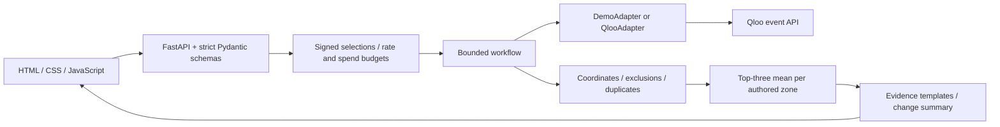

# TasteDistrict

**Find a city zone that fits your taste.** Choose 3–5 artists, films, books or places, explore up to three authored cultural discovery zones, then replace a favorite or exclude a place to see what changes.

Built as an independent Qloo Agentic Hackathon MVP. No Hatuli source, database or private materials are used. This is a cultural exploration application; it does not assess housing, safety, demographics, rents or travel times.

## Current status

The default **Demo data** mode runs locally with 18 fictional venues and authored synthetic affinity fixtures. Cultural titles are recognizable labels, but their IDs and associations are synthetic. Demo mode makes **zero external API or LLM calls**. It does not prove Qloo coverage or recommendation quality.

A server-side live adapter implements the documented event `GET /search` and `GET /v2/insights` surfaces. **No Qloo credential was available during development. Authenticated integration, city coverage, public deployment and the Qloo-versus-LLM-only comparison remain unverified. This project is not submission-ready.** Live failures never silently switch to synthetic results.

## LAN server

The designated development/runtime server is `nik@192.168.0.15`, with a separate checkout at `/home/nik/tastedistrict` and a dedicated `tastedistrict` container. Its LAN demo address is [192.168.0.15:8000](http://192.168.0.15:8000). Use this server for ongoing deployment and runtime checks; workstation localhost is an optional development fallback. See [deployment instructions](docs/DEPLOY.md) and the [verification record](docs/VERIFICATION.md) for observed deployment status. A LAN address is not the public hackathon demo URL.

```sh
ssh nik@192.168.0.15
cd /home/nik/tastedistrict
docker compose ps
docker compose logs --tail 50 tastedistrict
```

Port 8000 had no listener in the pre-deployment `ss -ltn` check. It is now bound specifically to `192.168.0.15` by TasteDistrict. The complete port check and operating procedure are in [DEPLOY.md](docs/DEPLOY.md).

## Run locally

Python 3.11 or later:

```powershell
python -m venv .venv
.\.venv\Scripts\python.exe -m pip install -c constraints.txt -e ".[test]"
Copy-Item .env.example .env
.\.venv\Scripts\python.exe -m uvicorn app.main:app --host 127.0.0.1 --port 8000 --no-access-log
```

On macOS/Linux replace `.\.venv\Scripts\python.exe` with `.venv/bin/python` and use `cp .env.example .env`. Open [localhost:8000](http://localhost:8000). Access logs are disabled so search query strings are not recorded by Uvicorn; use the same setting in hosting/proxy logs.

Try the example searches **Nina Simone**, **Amélie**, **The Little Prince**. Select each exact match, then choose **Find my places**. Replace Nina Simone with **Radiohead**, refresh, and inspect added/removed places and zone order. Exclude a place using its × button. **Why this place?** shows the actual synthetic association or the live Qloo candidate-order evidence.

## Enable live Qloo

Request a **hackathon event key** through the [official API key request form](https://forms.gle/zz12orkLHTAneLGz6), linked from the [event developer guide](https://docs.qloo.com/reference/qloo-llm-hackathon-developer-guide#getting-your-api-key) and the current [Devpost event](https://qloo.devpost.com/). Qloo manually approves requests and delivers keys by email, normally within a few business days. The form requires a project idea: describe TasteDistrict's cultural-favorites-to-city-places workflow. Registration, form submission and agreement acceptance must be completed by the human entrant. Event keys work with the event host below, not production/staging. Sources and quota uncertainties are recorded in [SOURCES.md](docs/SOURCES.md).

On the designated server, edit the existing private environment file:

```sh
ssh nik@192.168.0.15
cd /home/nik/tastedistrict
nano .env
```

Set these values in **`/home/nik/tastedistrict/.env`**:

```dotenv
DATA_MODE=live
QLOO_API_KEY=<your event credential, server only>
QLOO_BASE_URL=https://hackathon.api.qloo.com
```

Preserve the existing generated `APP_SECRET`. This file already has owner-only permissions (`600`) and is ignored by Git. Never enter a key in the browser, commit it, paste it into a prompt, or include it in logs. The only outbound API host is the documented event host; redirects are disabled. Check the assigned credential's terms/quota and perform the bounded live smoke before activating the running service:

```sh
docker compose config --quiet
docker compose run --rm --no-deps --entrypoint python \
  -v "$PWD/scripts:/smoke:ro" tastedistrict /smoke/live_smoke.py
# If the smoke check passes:
docker compose up -d --force-recreate
curl --fail http://192.168.0.15:8000/api/config
```

**Editing `.env` requires recreating the container. `docker restart` alone keeps its previous environment.** An environment-only update does not need an image rebuild. Use `docker compose config --quiet`; the verbose version can expose resolved environment values.

The smoke command refuses demo mode. In live mode it spends a bounded allowance on real searches and recommendations and prints a **summary only**, never raw responses or the key. It must pass before claiming a working integration. A config response with `mode=live` confirms only the selected configuration; verify real search/results in the browser too. Three useful zones require several unique eligible venues in each; sparse coverage becomes a clearly labeled city-place list. If New York coverage is inadequate, investigate another city before adding it to the supported list.

## Architecture



- `app/qloo.py`: credential isolation, documented requests, bounded payloads, retries and schema validation.
- `app/workflow.py`: resolve signed search selections → retrieve candidates → validate → at most one expansion → rank → explain. Its visible action log contains executed steps, not model reasoning.
- `app/ranking.py`: no density bonus; each zone's score averages its three strongest place scores. Live per-place scores derive from Qloo order (`100 × (1 − zero_based_rank / 50)`), independent of response length. They are application rankings, never compatibility probabilities.
- `app/data.py`: original comparison rectangles and synthetic fixtures. These are **authored exploration zones**, not administrative boundaries. The coordinate guard is approximate; the live Qloo locality constraint supplies upstream city scope.
- `app/static/`: responsive English interface, semantic controls, keyboard search, safe text rendering and explicit data provenance.

Structured input and fixed evidence templates work without an LLM. `LLM_PROVIDER=none` is the only enabled provider in this build; no paid LLM service was connected. A provider abstraction/free-form parser is deferred until a provider and its costs are approved. No LLM-only performance result is claimed.

## Limits and privacy

- Up to **10 Qloo attempts per scenario**, including favorite search, retries and the optional expansion. A successful recommendation closes the scenario; subsequent edits begin the next one. **Start new scenario** resets the scenario allowance, never the global allowance.
- Up to **500 upstream attempts per worker lifetime** by default. This counts calls, not currency; the operator must match it to the credential quota. One process is required. The allowance resets on restart, so provider/account quota controls are still necessary.
- At most two HTTP attempts per operation, bounded timeout, 2 MB upstream payload, 40 application requests/minute per direct client IP and bounded session memory. Reverse proxies need correct trusted proxy configuration. These are MVP guards, not distributed abuse prevention.
- No registration, database, persistent cache, external fonts or bundled map tiles. Signed, expiring selection tokens are session-bound; browser refresh loses the selected UI state. Selected cultural entities and city are sent to Qloo only in live mode. No user identity or precise personal location is requested.
- Raw API responses and search text are not saved by the application. Qloo has its own terms and retention behavior. The app's MIT license does not license Qloo data. See [dependency notices](docs/DEPENDENCIES.md).

## Validation

```powershell
.\.venv\Scripts\python.exe -m pytest -q
.\.venv\Scripts\python.exe scripts/evaluate.py
docker build -t tastedistrict:local .
docker run --rm -p 8000:8000 --env-file .env tastedistrict:local
```

Tests use authored synthetic response fixtures, never saved Qloo data. Evaluation runs 12 reproducible synthetic scenarios; it reports functional checks, latency and request counts, **not real-world place existence or subjective quality**. See [the evaluation protocol](eval/PLAN.md), [verification record](docs/VERIFICATION.md), [deployment steps](docs/DEPLOY.md), and [submission checklist](docs/SUBMISSION.md).

## License

Original code, synthetic fixtures and authored zone geometry: [MIT](LICENSE). Retain dependency notices and their license texts when redistributing. No third-party artwork, municipal boundary dataset or Qloo response dump is included. Credential-specific display/attribution rights and organizer permission for AI coding still need confirmation; silence in the rules is not permission.
